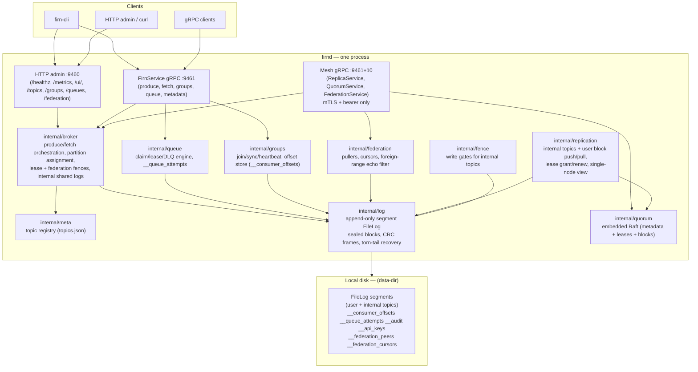
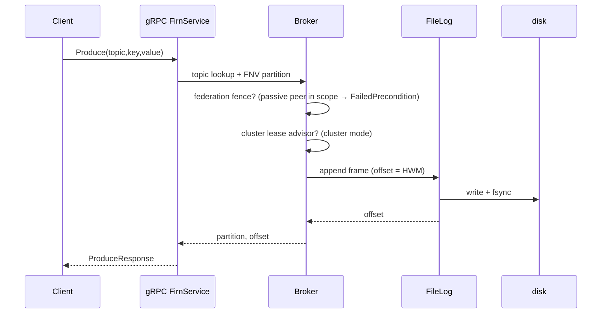
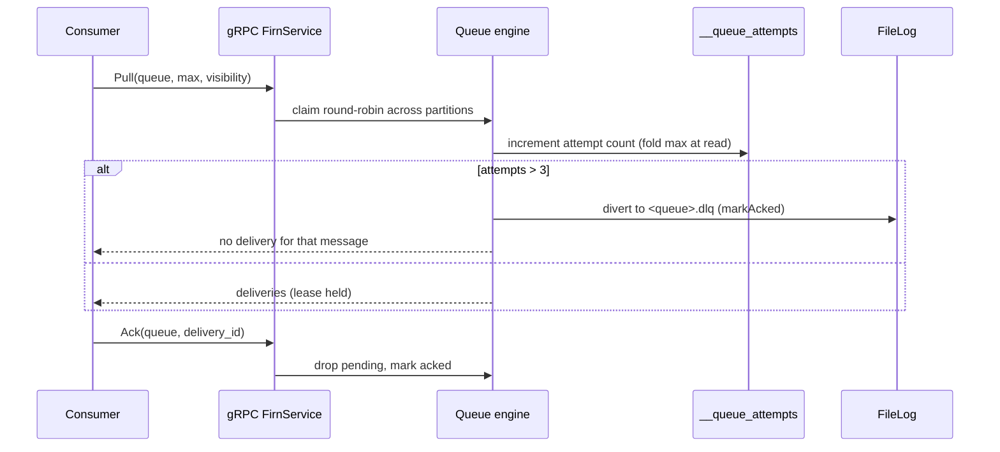
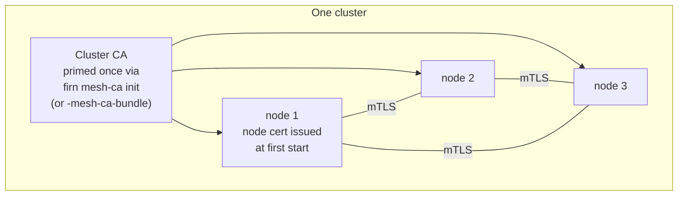
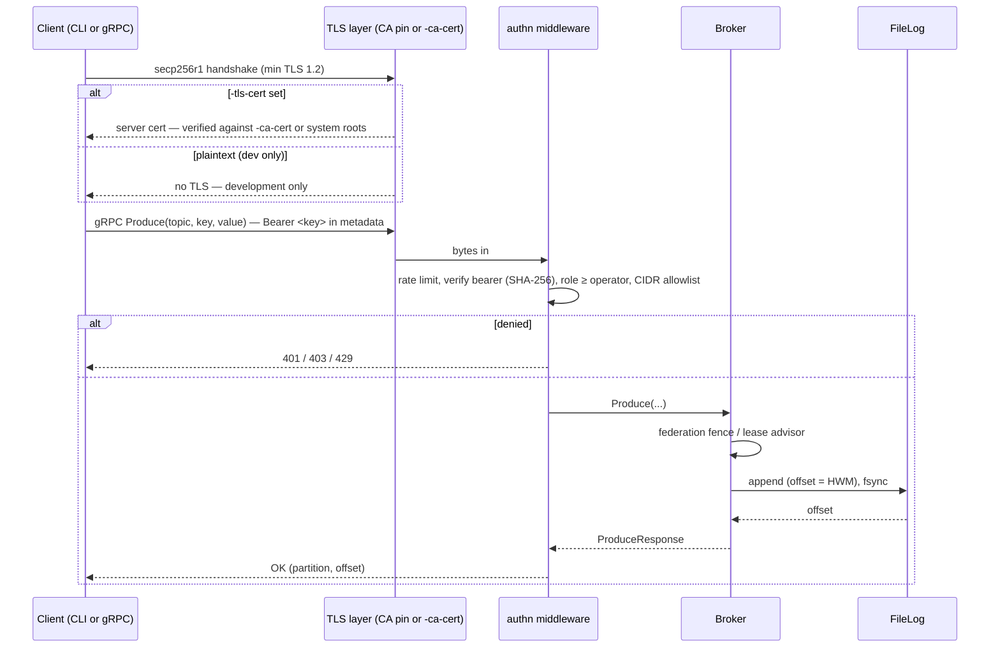
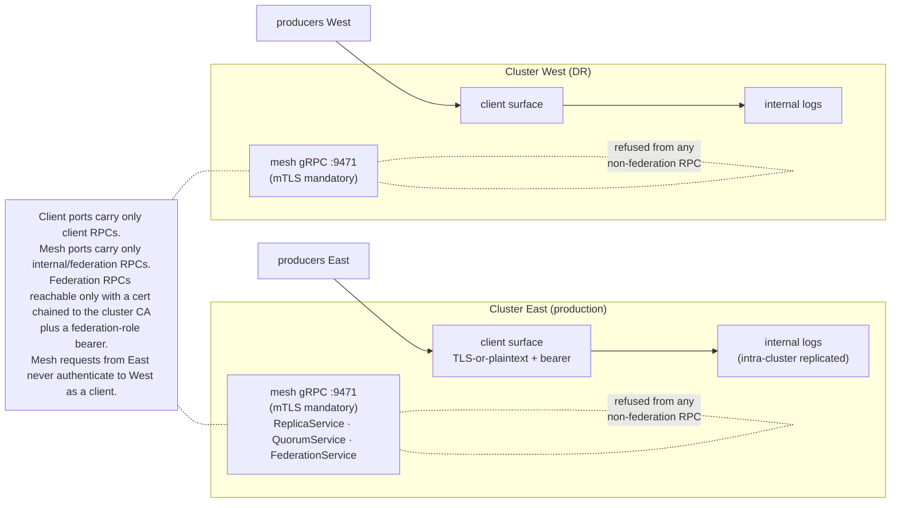
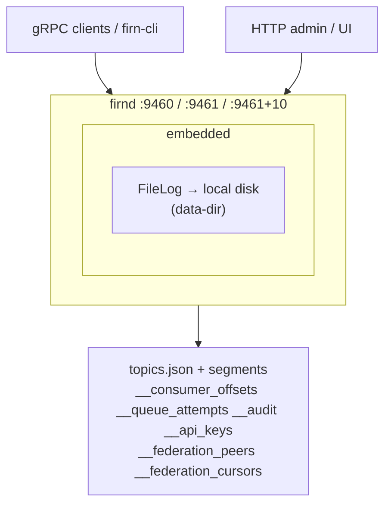
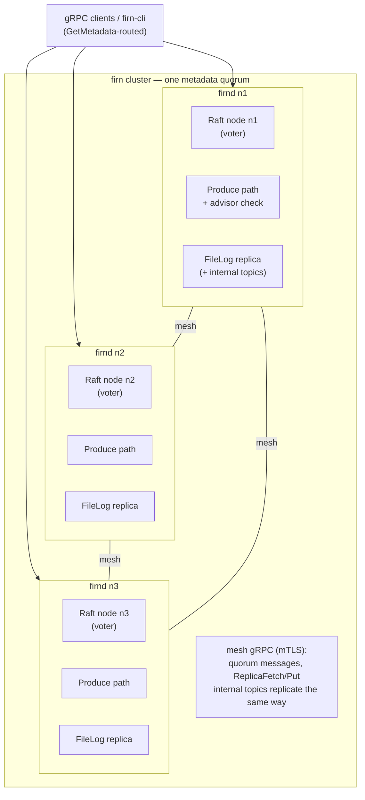
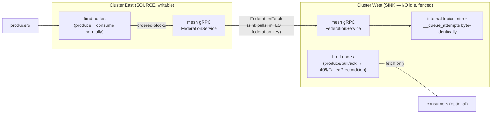
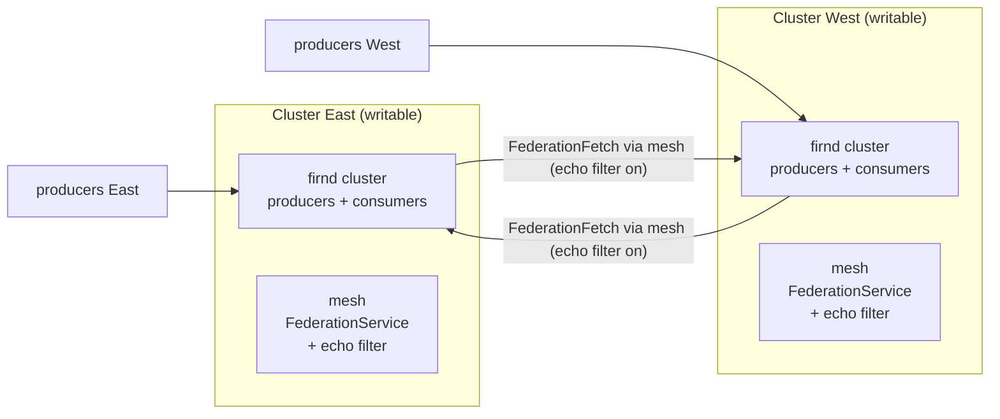

# ADR-012: Architecture — components, interactions, deployment topologies

Status: accepted · 2026-11-13 · living document: the diagrams in this file are canonical for the current tree and must be updated in the same commit as any component or topology change.

## Context

Firn began as one binary with a storage engine (v0.1.0). It is now a single-node broker, an HA cluster, and a multi-cluster federated system — built in one repository, one process, one module. Reviewers and operators need one place that answers: what are all the pieces, what does each one do, how do they interact, and what does each deployment look like from the outside. The ADRs answer *why*; this ADR is the map of *what*.

Before choosing an approach, three facts constrained the shape:

1. Everything ships in one binary (`firnd`) — no microservices, no separate processes. Topology differences are flags, not services.
2. All inter-process hops (HTTP admin, client gRPC, mesh gRPC) are explicit listeners; internal RPCs never ride the client port (ADR-011).
3. Federation is pull-only in v1 (ADR-010) — topologies show data flow, not connections we don't have.

## Decision

The canonical architecture description is this ADR: one page of system context, a component catalog grouped by plane, a set of numbered interaction flows, and four deployment topologies (standalone, HA cluster, active/passive federation, active/active federation). Diagrams are Mermaid (renders on GitHub) embedded inline — no binary assets, no external diagram tooling. Any change that adds, removes, or rewires a component updates this file in the same commit.

Non-canonical detail stays in code; this file is the table of contents and the interaction contract.

## The system at a glance



## Component catalog

Grouped by plane. Every path is relative to the repository root. `ADR-NNN` links to the decision record that owns the design.

### Data plane

| Component | Path | What it does | Invariants / notes |
|---|---|---|---|
| FileLog | `internal/log` | Append-only per-partition segment log. Segments roll by size (`-segment-bytes`) or age (`-block-seal-interval`); CRC-framed records; torn-tail truncate on open; retention deletes **whole segments only**. | Offsets monotonic from 0, never reused. Fetch never returns records ≥ HWM. fsync per append. `MemLog` is dev-only. (ADR-003) |
| Broker | `internal/broker` | Assigns partitions (FNV of key / round-robin keyless), serializes appends, enforces lease + federation fences, exposes the six internal shared logs (`InternalLog`), holds routing metadata. | HWM-only fetches. Internal shared logs are byte-identical replicated in clusters. Storage review required for diffs here and in `internal/log`. (ADR-003, ADR-007) |
| Meta registry | `internal/meta` | Topic registry persisted in `topics.json` (atomic rename); single writer (quorum apply hook in clusters). | Topics carry mode (`stream`/`queue`) and partition count; partitions are fixed at creation. (ADR-001, 007) |
| Retention | `internal/broker` (sweeper) | TTL/byte retention via whole-segment deletion on a ticker. | Never deletes the active segment. (ADR-003, ADR-009) |

### Consumption semantics

| Component | Path | What it does | Invariants / notes |
|---|---|---|---|
| Consumer groups | `internal/groups` | JoinGroup/SyncGroup/Heartbeat/LeaveGroup/CommitOffset/FetchOffset over `__consumer_offsets`; coordinator re-balances by range/member. | Commits advance monotonically. Client commits via `CommitOffset`; reads via `FetchGroupOffsets`. (ADR-001) |
| Queue engine | `internal/queue` | Pull claims messages with visibility leases; lease-expired messages redeliver first; `maxDeliveries = 3` then divert to `<queue>.dlq`. Records attempts in `__queue_attempts`. | Ack deletes the pending entry. Attempts fold max at read. (ADR-001) |
| Attempts store | `internal/queue` | Folded `max(attempts)` per `queue\x00partition\x00offset`; negotiated with DLQ divert. Replicates byte-identically in clusters; re-keyed for active-active federation. | Writers fail closed when fenced (cluster mode, non-lease-holder nodes). (ADR-001, 010) |

### Consistency & replication (cluster mode only)

| Component | Path | What it does | Invariants / notes |
|---|---|---|---|
| Quorum (metadata) | `internal/quorum` | Embedded Raft over the mesh listener: topic creation, block commit descriptors, lease grant/revoke/renew entries. Pre-vote + current-term-majority commit; single-node mode needs nothing here. | One quorum owns the cluster's truth for metadata; followers apply deterministically. (ADR-007) |
| Replication agent | `internal/replication` | Per sealed user-topic or internal block: pushes via `ReplicaPut` to peers (seal push), pulls via `ReplicaFetch` on recovery (repair), maintains write leases with epochs and TTL. | Blocks are content-addressed (hash of frames) — equality is checkable. Byte-identical replicas. Advisor veto gates produces on non-lease nodes. (ADR-007) |
| Write leases | `internal/replication` + `internal/fence` | Only the lease holder may append (produce, internal logs). Leases expire; the quorum re-grants. `fence.GateBox` is checked on internal-log writes. | Cluster: non-lease nodes fail closed on writes. Single-node: advisor absent, all writes allowed. (ADR-007, 011) |
| Mesh CA | `internal/meshca` | Issues node certs from a CA rooted at `<data-dir>/mesh-ca`; `Ensure()` auto-provisions single-node CAs; pre-provisioned CA required for clusters (`-mesh-ca-bundle`). | mTLS only on the mesh listener; no API keys there. (ADR-011) |

### API plane

| Component | Path | What it does | Invariants / notes |
|---|---|---|---|
| HTTP admin | `internal/api` | `/healthz` (public), `/metrics` (keyed), `/ui/` (keyed), `/topics`, `/groups`, `/queues/*`, `/federation/*`, `/apikeys`. | Every endpoint except `/healthz` requires a bearer key once any key exists. (ADR-008, 011) |
| gRPC FirnService | `internal/api/server.go` | Produce, Fetch, group RPCs, queue Pull/Ack, `GetMetadata` (client routing). | Role-scoped per RPC: viewer/operator/admin. Federation keys get `Unimplemented` everywhere else. (ADR-001, 002, 011) |
| Mesh services | `internal/api/replica.go`, `quorum.go`, `federation.go` | `ReplicaService`, `QuorumService`, `FederationService` — mesh only. | Never reachable from client ports; `FederationService` is mTLS + federation-scoped key. (ADR-010, 011) |
| Admin UI | `internal/adminui` | Read-only HTML: topics, groups, federation peers/cursors (`/ui/federation`). | Read-only by design; mutations only via admin API/CLI. (ADR-008, 011) |
| CLI | `cmd/firn-cli` | All admin + produce/fetch/groups/dlq/apikeys/federation/mesh-ca flows; route-aware fetch/produce (uses `GetMetadata`). | `firn-cli` never bypasses auth; keys come from env/flags. (ADR-008) |
| Metrics | `internal/metrics` | Prometheus: `firn_produce_total`, `firn_fetch_total`, `firn_fsync_seconds`, `firn_group_rebalances_total`, `firn_queue_depth`, `firn_federation_cursor_lag_seconds`. | `/metrics` keyed by default. (ADR-006) |

### Identity & security

| Component | Path | What it does | Invariants / notes |
|---|---|---|---|
| API keys | `internal/apikeys` | Keys minted at `POST /apikeys` (bootstrap token) or `POST /federation/keys`; stored SHA-256-hashed in `__api_keys`; roles: `viewer`, `operator`, `admin`, `federation`. | Federation keys may call only `FederationService`. Never returned after mint (except federation keys minted for self). (ADR-008, 011) |
| Rate limits | `internal/ratelimit` | Per-key token bucket (`-rate`); per-IP sliding window for anonymous traffic (`-anon-rate`). | Anonymous window covers `/healthz` probes and all unauthenticated refusals. (ADR-011) |
| Audit log | `internal/audit` | Append-only `__audit` for admin mutations and refused touches; optional byte budget with operator-driven rotation. | Rotation is manual (documented). (ADR-008, 011) |
| Secure boot | `cmd/firnd` | Fail-closed startup: no keys → one-time `BOOTSTRAP TOKEN` on stderr → `POST /apikeys` mints exactly one admin key, enforced thereafter. | `-dev`/`-allow-open-bootstrap` are loud opt-outs. Dir mode check refuses permissive data dirs. (ADR-011) |

### Federation (inter-cluster)

| Component | Path | What it does | Invariants / notes |
|---|---|---|---|
| Control plane | `internal/federation` (peers/cursors), `__federation_peers`, `__federation_cursors` | Peer registration (out-of-band, per-cluster), cursor tracking per `(peer, topic, partition)`, foreign-applied local range recording (echo filter source). | Internal topics are replicated **within** each cluster; **never** federated themselves. Cursor log compacts by upsert. (ADR-010) |
| Passive puller | `internal/federation/puller.go` | One-way import: fetch `[cursor, sourceHwm)` from peer, byte-identical apply preserving offsets. | `__queue_attempts` mirrors byte-identically; queue records ride with named queues. Sink fenced until cutover. (ADR-010, plan 004) |
| Active-active puller | `internal/federation/puller.go` | Two-way: re-origin import (`broker.AppendReoriginedFrames`), ts/key/value preserved; records local ranges per import. Attempts mirror both ways with re-keyed offsets (source message offsets translated via foreign ranges; peer publishes its own via `FederationReport`). | Echo prevention is serving-side filtering on `FederationFetch` (foreign ranges); `-federation-self` names the caller's cluster to the peer. (ADR-010, plan 004) |
| FederationService | `internal/api/federation.go` | `FederationFetch` (CRC-checked frame windows, serving-side echo filter), `FederationReport` (HWM + partition count + `foreign_ranges` for inverse attempts re-keying). Mesh-only. | `__queue_attempts` is the one internal topic served. All others refused. Reports publish this node's foreign-applied ranges — no secrets (peer-content bytes only). (ADR-010) |

### Ops & support

| Component | Path | What it does | Invariants / notes |
|---|---|---|---|
| E2E tests | `test/e2e_test.go` | Boot real daemons; multi-cluster and restart flows. | Runs in CI with `-race`. |
| Benchmarks | `bench/` | Produce/fetch baselines with `-benchmem`. | Used for perf regressions, not gates. |
| Build & dist | `.github/workflows/`, `docs/distribution.md` | Multi-arch tarballs, SBOM (syft), grype `fail-on-critical`, cosign sign-blob (manual step), MIT license. | No release artifacts without manual sign-off. |

## The interactions that matter

### 1. Produce (single node)



Fetch is the mirror: HWM-clamped slices of `[offset, offset+max)`, served from memory/segment files; never ≥ HWM.

### 2. Queue claim & DLQ



Lease-expired messages redeliver first. A claim sees attempts increment by one; once attempts exceed `maxDeliveries` (3) the message is diverted to `<queue>.dlq` and marked acked — no redelivery of it.

### 3. Cluster: produce with a lease (and how followers catch up)

```mermaid
sequenceDiagram
    participant C as Client
    participant B as Any node (write path)
    participant ADV as Replication advisor
    participant Q as Quorum (Raft)
    participant F as FileLog
    C->>B: Produce(topic,...)
    B->>ADV: WriteAllowed(topic, partition)?
    ADV->>Q: lease table lookup (epoch, holder, expiry)
    Q-->>ADV: yes/no (this node holds the lease)
    alt this node is lease holder
        B->>F: append (HWM-ordered)
        F-->>B: ok
        B->>B: sealer seals full segments; agent pushes blocks (ReplicaPut)
        B->>Q: EntryBlockCommit (block descriptor)
        B-->>C: offset
    else another node holds the lease
        B-->>C: FailedPrecondition (routes via GetMetadata on the client)
    end
```

Followers: agent notices committed block descriptors; missing blocks are pulled via `ReplicaFetch` and applied byte-identically. Internal topics use the same machinery with a single write lease per internal topic.

### 4. Federation, passive (active/passive)

```mermaid
sequenceDiagram
    participant APP as Operator
    participant SINK as Sink
    participant SRC as Source
    APP->>SINK: POST /federation/peers {direction:"in", mode:"passive", topics:[...]}
    Note over SINK: sink is fenced — produce/pull/ack → 409/FailedPrecondition
    SINK->>SRC: FederationFetch(topic, partition, first=cursor+1) — mTLS + federation key
    SRC-->>SINK: raw CRC-checked frames (first to HWM)
    SINK->>SINK: ParseFrames → AppendReplicatedFrames (byte-identical)
    SINK->>SINK: upsert __federation_cursors cursor
    Note over SINK: clients read mirrored data immediately; writes rejected until cutover
```

### 5. Federation, active-active

```mermaid
sequenceDiagram
    participant A as Cluster A (writable)
    participant B as Cluster B (writable)
    A->>A: local produce → frames at A-offsets
    B->>A: FederationFetch (A filters A-origin frames out)
    A-->>B: only B-origin or unseen frames
    B->>B: AppendReoriginedFrames (fresh B-offsets, ts/key/value preserved)
    B->>B: record foreign ranges (A→B) in cursor
    B->>A: FederationFetch, and the symmetric filter (B-origin omitted)
    Note over A,B: consumer on either cluster sees all records; global order undefined
```

## Security architecture

Security in firn is **fail-closed by default** and layered: transport encryption → authentication → authorization → rate limiting → audit. This section diagrams every path from a CLI/browser to a byte in the log, and the two-cluster federation case, which is the only scenario where anything leaves the cluster.

### The threat model in one paragraph

Attackers: (a) anonymous network probers — they get `/healthz` and 401s, nothing else, with a tight per-IP sliding-window cap; (b) key holders with limited roles — viewers read, operators produce/consume, federation peers call only federation RPCs; (c) a compromised cluster node — mesh mTLS means its flat network peer cannot reach internal RPCs without a cert, and role-scoping means even an impostor's keys are not admin; (d) OS-root insiders — out of scope by design (`__audit` is append-only for external callers, not tamper-evident against root). Explicitly not defended: at-rest encryption (files are `0600` under a `0700` dir; the log format has no encryption driver), FIPS-validated crypto, HSM-backed keys (ADR-011 non-goals).

### Layer 1 — transport encryption

**Client surface (HTTP admin, gRPC `FirnService`): plain TLS, per-node, optional.**

```sh
firnd -tls-cert cert.pem -tls-key key.pem
```

Both listeners share one cert (its SANs must cover every host/IP clients dial), minimum TLS 1.2. No client certificates — clients authenticate with API keys (below). Leaving both flags empty = plaintext for development; `docs/install.md` leads with the TLS+mTLS path precisely because plaintext is a test-mode failure mode, not a deployment.

**Mesh surface (`ReplicaService`, `QuorumService`, `FederationService`): mutual TLS (mTLS), mandatory.**



- A **dedicated mesh listener**, separate from client ports — internal RPCs never ride the public port, so they cannot be reached without the CA at all.
- The mesh is **strictly mutual**: the server requires and verifies client certs signed by the cluster CA; each node's identity (CN/DNS SAN = node ID) is verified against the `ServerName` you expect.
- Node certs are issued by the CA at first start from a locally generated key; `node.crt`/`node.key` are written to `<data-dir>/mesh-ca/` with `0600`.
- Single-node installs auto-provision the CA with zero operator action; multi-node clusters pre-share one CA (generated once with `firn mesh-ca init`, copied into each node's `mesh-ca/` with `0600`) — or are handed `-mesh-ca-bundle`/`-mesh-ca-key` for full pre-provisioning.
- Client surface TLS and mesh mTLS are **independent** — disabling one never disables the other, and there is no flag that does so.

### Layer 2 — authentication & authorization

API keys are bearer tokens. They are shown **exactly once** at mint (`POST /apikeys` or `POST /federation/keys`), stored SHA-256-hashed in the replicated `__api_keys` internal log, revocable at any time. Roles (cumulative):

| Role | May call |
|---|---|
| `viewer` | read-only RPCs & GETs (fetch, offsets, groups, topic list, metrics, `/ui/`) |
| `operator` | produce, queue `Pull`/`Ack`, group membership verbs, offset commits |
| `admin` | everything — key lifecycle, admin mutations, all operator verbs |
| `federation` | **only** `FederationService` RPCs — never produce/fetch/ack/admin |

Enforced at both edges, fail-closed:

| Surface | What runs before any handler | Refused caller sees |
|---|---|---|
| HTTP admin | `HardeningMiddleware` (CSP `default-src 'self'`, `frame-ancestors 'none'`, `X-Frame-Options: DENY`, `Referrer-Policy: no-referrer`, `Cache-Control: no-store`) → `authorizer.Wrap` (bearer verify, role, rate limit, IP allowlist) | `401` (unauthenticated) or `403` (valid key, wrong role/IP) |
| gRPC | `GRPCInterceptor` — logging → bearer verify → per-RPC role check (`grpcRoles` table) → rate limit → CIDR allowlist | `UNAUTHENTICATED`, `PERMISSION_DENIED`, `RESOURCE_EXHAUSTED` |
| Mesh | the transport itself — client cert signed by the CA; no bearer needed for internal RPCs (federation RPC is the exception: federation key required **and** it buys nothing else) | TLS handshake error |
| `/healthz` | nothing | always `200 {"status":"ok"}` (public by design) |

A federation key can never satisfy a non-federation RPC (`grpcRoles` denies any FD that is not `RoleFederation`); an admin key *cannot* call `FederationService` either — only federation keys open it.

### Layer 3 — rate limiting, IP allowlists, audit

- **Per-key token bucket** (`-rate`, default 100 ops/s) enforced at HTTP and gRPC — uniform cost model across both edges.
- **Per-IP sliding window** (`-anon-rate`, default 20/min) on anonymous traffic — covers `/healthz` probes and unauthenticated refusals alike, so a port scan can't fan out.
- **Per-key CIDR allowlists** (`allowed_ips` at mint) — refused with 403/`PERMISSION_DENIED`; recorded as `authz-refused:ip-not-allowed` in `__audit`.
- **`-dir-mode-check`** refuses startup if any file under `-data-dir` is group/world-accessible (`0700`/`0600` required) — no key leakage via disk perms.
- **Audit**: every admin mutation and every authz refusal, in **every** auth mode, is appended to `__audit` (bounded by `-audit-max-bytes`, default 64 MiB; past budget → writes refused with 503 until an operator rotates).
- **Metrics (`:`/ui/`)**: viewer-key-gated by default (`/ui/` and `/metrics` return 403 without one; `-metrics-auth=false` opts out deliberately).

### Layer 4 — bootstrap & secret handling

```mermaid
sequenceDiagram
    participant Op as Operator
    participant F as firnd (first boot)
    Op->>F: firnd (fresh, zero keys)
    F-->>Op: stderr: BOOTSTRAP TOKEN: <hex>  (printed once)
    Op->>F: POST /apikeys Bearer <token> {"name":"root","role":"admin"}
    F-->>Op: 201 + plaintext key (shown once; never stored)
    Note over Op: token is void from this request on
    Op->>F: POST /apikeys (later requests) — requires a real key
```

- Federation keys are created **out-of-band on the serving cluster**, pasted into the peer's registration — material never crosses the wire and never persists anywhere a leaky port could reach.
- Node certs are generated per node from a CA that never leaves operator custody; only `ca.crt` is distributed, never the CA private key.
- `firn-cli` reads keys from `-api-key`/`FIRN_API_KEY` only — never from config files, never echoed in output.

### The client path, end to end



Cluster mode: the same path with one extra check — produces only land on the lease holder; non-holders return `FailedPrecondition` and route clients fetch fresh routing from `GetMetadata`.

### Two clusters federated — the full security picture



- Both directions dial out over mTLS with the shared mesh CA (or a pinned per-peer CA registered with `ca_crt_pem`); neither side opens a listener for the other.
- A federation key minted on East opens exactly two RPCs on East's mesh (`FederationFetch`, `FederationReport`); it cannot produce, fetch user topics, ack queues, or call admin endpoints, and East will not serve `__audit`, `__api_keys`, `__consumer_offsets`, or `__federation_*` — the only internal topic served is `__queue_attempts` (re-keyed for active-active).
- The `requesting_peer` hint (`-federation-self`) and each side's foreign-applied ranges are what prevents A→B→A echoes — East never sees the frames it donated to West (they are filtered at the serving edge).
- Audit on both clusters records every federation key minted and every registration change; `firn federation status` shows exactly what moves and with which cursor.

### What is intentionally absent

- No SSO, no LDAP/OIDC integration — firn is an infrastructure broker; operators own identity.
- No per-topic ACLs (only coarse viewer/operator/admin roles) — ADR-011 non-goals.
- No encryption at rest or FIPS — files are `0600`/`0700`; a KMS integration would be its own ADR.
- No remote attestation or service mesh — mesh is firn's own mTLS, not Istio/Linkerd.

## Internal topics

Six shared, single-partition internal logs in every deployment. In clusters they replicate like user topics (byte-identical, lease-gated writes for non-holders, all readable everywhere). They are **never** federated.

| Topic | Purpose | Key format | Value | Compaction |
|---|---|---|---|---|
| `__consumer_offsets` | `CommitOffset` records | `group\x00topic\x00partition` | offset (ASCII) | upsert every 1000 |
| `__queue_attempts` | Claim/DLQ attempt counters | `queue\x00partition\x00offset-ascii` | u32 BE | fold-by-max at read; physical compaction every 1000 increments (single node) |
| `__audit` | Admin mutations & refusals | ISO timestamp + actor | JSON summary | budget rotation (manual) |
| `__api_keys` | Hashed API keys | key name | hash + role + allowlist + CIDRs | append on mutation; folded at open |
| `__federation_peers` | Federation peer registry | peer name | JSON peer + key | none yet (low volume) |
| `__federation_cursors` | Federation import progress | `peer/topic/partition` | JSON cursor + foreign ranges | upsert on import |

## Deployment topologies

### A. Standalone (single node)



**Use when:** development, small deployments, edge sites, a single backend worker pool. Simplicity over availability.

| Property | Behavior |
|---|---|
| Durability | Local disk + fsync; survives process restart; **single copy** — disk loss = data loss. |
| Availability | No HA. Restart briefly unavailable. |
| Consistency | Total order per partition locally; no replication semantics needed. |
| Federation | Can act as source or sink to other standalone/cluster deployments (active/passive or active/active). |

### B. Cluster (HA, one failure domain)



**Use when:** a production service needs node-loss tolerance without cross-domain complexity. This is the default for serious deployments.

| Property | Behavior |
|---|---|
| Durability | ≥ 2 byte-identical replicas of sealed blocks (segment replication); quorum metadata decides what is committed. |
| Availability | Cluster survives the loss of a minority of nodes; leases re-grant on lease holder failure. |
| Consistency | Single metadata quorum; produces allowed only on lease holders; fetches match segment order. |
| Failure modes | Partition of a minority = degraded but safe; majority loss = metadata unavailability (produces fail, reads may serve stale-but-consistent blocks). |
| Federation | The whole cluster federates as one peer to other clusters; each cluster's internal topics remain local. |

### C. Multi-cluster — federation active / passive (one-way DR)



**Use when:** DR site, read-scaling replica, cache-warming shadow, regulated cross-region mirroring with one writer.

| Property | Behavior |
|---|---|
| Registration | Out-of-band: the sink mints nothing for the source to call — only the sink authenticates outbound. Peer registered with addr + optional `ca_crt_pem` (shared CA is the default topology; `-federation-self` only when both directions ever run). |
| Write path | Source only. Sink is fenced: produce → `FailedPrecondition` (gRPC) / `409` (HTTP); queue pull/ack → `409`. |
| Consistency | Byte-identical blocks; offsets preserved; HWM order identical to source. Lag = `firn_federation_cursor_lag_seconds`. |
| Cutover | Operator removes peer registration on the sink (or flips its mode) and starts producing locally; DLQ/attempts state has already converged via the byte-identical mirror. |
| Failure modes | Peer down → import stalls, no data loss (cursor stalls); source wipe = reseed procedure (documented with the cutover runbook); selective scoping — only configured topics/queues move. |

### D. Multi-cluster — federation active / active (full bidirectional)



**Use when:** two regions both need write availability (edge + cloud, active-active DR with zero RPO tolerance for write loss, independent failure domains).

| Property | Behavior |
|---|---|
| Registration | Both clusters register each other, same mode (`active-active`), direction `both`. Partition counts must match or the import refuses to run. |
| Write path | **Both sides accept writes at any time.** Records are re-originated per cluster (fresh offsets; ts/key/value preserved). |
| Consistency | No global order. Each partition is monotonic per cluster. `federation_hwm` is advisory (min across inbound peers). Duplicate delivery possible across clusters (at-least-once; dedupe at consumer or DLQ). |
| Echo prevention | Serving-side filter omits frames this cluster imported from the requesting peer — no headers, no content-hash. (`-federation-self` required per cluster.) |
| Convergence | Cursors advance per `(peer, topic, partition)`; both clusters eventually hold the same record set. `__queue_attempts` mirrors both ways for federated queues (slice 5); competing consumers per cluster each see at-most-once, DLQ contents converge. |
| Failure modes | Peer down → that peer's records stall; local writes continue; resumption from cursors on reconnect. Partition mismatch → no import (loud error). |

## Listener and port summary

Defaults (all overridable):

| Listener | Flag | Default | Contents | Auth |
|---|---|---|---|---|
| HTTP admin | `-http-addr` | `:9460` | `/healthz` (public), `/metrics`, `/ui/`, admin API | Bearer once any key exists |
| Client gRPC | `-grpc-addr` | `:9461` | `FirnService` (all client RPCs) | Bearer + role |
| Mesh gRPC | `-mesh-addr` | `grpc-addr` + 10 ports | `ReplicaService`, `QuorumService`, `FederationService` | mTLS (mesh CA) + bearer (federation only for FederationService) |

## Operator documentation map

Where to find the operator-facing companions to each plane:

| Topic | Document | What it covers |
|---|---|---|
| Getting started / install | `docs/install.md` | Secure-by-default boot, single node, 3-node HA cluster, **two-cluster federation quickstart** |
| Configuration reference | `docs/configuration.md` | Every flag with defaults; security model (fail-closed, bootstrap modes); internal-topic paths |
| API reference | `docs/api.md` | All endpoints, authn/authz rules, error codes, federation surface, `firn-cli` ↔ API map |
| Federation cutover | `docs/federation-cutover.md` | Operator procedure: passive sink → writable (active-active flip or standalone decommission) |
| Distribution / release | `docs/distribution.md` | Multi-arch tarballs, SBOM (syft), grype `fail-on-critical`, cosign sign-blob (manual) |
| Metrics | `docs/adr/006-metrics.md` | Prometheus metric definitions incl. `firn_federation_cursor_lag_seconds` |
| Migration | `docs/migration-v0.3-to-v0.4.md` | v0.3 → v0.4 breaking changes & upgrade ordering |
| HA design | `docs/adr/007-scaled-deployment.md` | Quorum, leases, block replication, client routing |
| Federation design | `docs/adr/010-federation.md` | Registration, passives/actives, echo filter, failure modes |
| Security model | `docs/adr/011-secure-mode.md` | Fail-closed boot, bootstrap token, mesh mTLS, key roles |
| This file's plan sketch | `docs/plans/004-federation.md` | Federation delivery history slice by slice |

## Non-goals for this ADR

- Protocol/wire documentation (that is `docs/api.md`).
- Decision rationale for each subsystem — each subsystem's ADR owns that.
- Performance numbers (see `bench/baseline.md`).
- Release process (see `docs/distribution.md`).

## Consequences

- This file is now part of the review checklist for any PR that touches a component listed above — stale diagrams are a review defect, not a documentation nit.
- New components are impossible to merge without a component-catalog entry in the same PR. The catalog groups by plane, not by package, on purpose: planes rarely change, packages do.
- ADR-012 supersedes nothing; it consolidates what changed shape across ADR-007 (HA), ADR-010 (federation), and ADR-011 (secure-by-default), and is the fastest way to orient on this codebase.
- Diagrams are Mermaid in-markdown precisely so they can be diffed, reviewed, and rejected like code.

## Maintenance notes

- Keep component tables sorted within their plane.
- `federation_hwm`, `-federation-self`, and the `/ui/federation` page are all post-v0.3.0 additions; earlier releases of this file may lack them — this doc tracks the current tree, not any tag.
