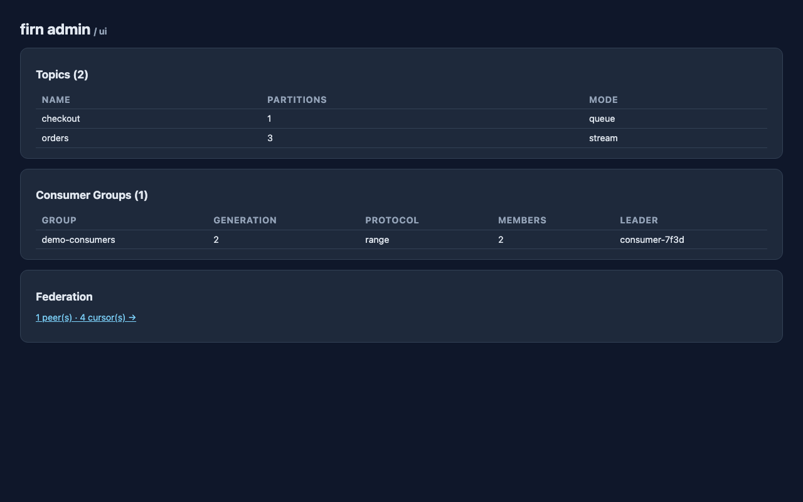
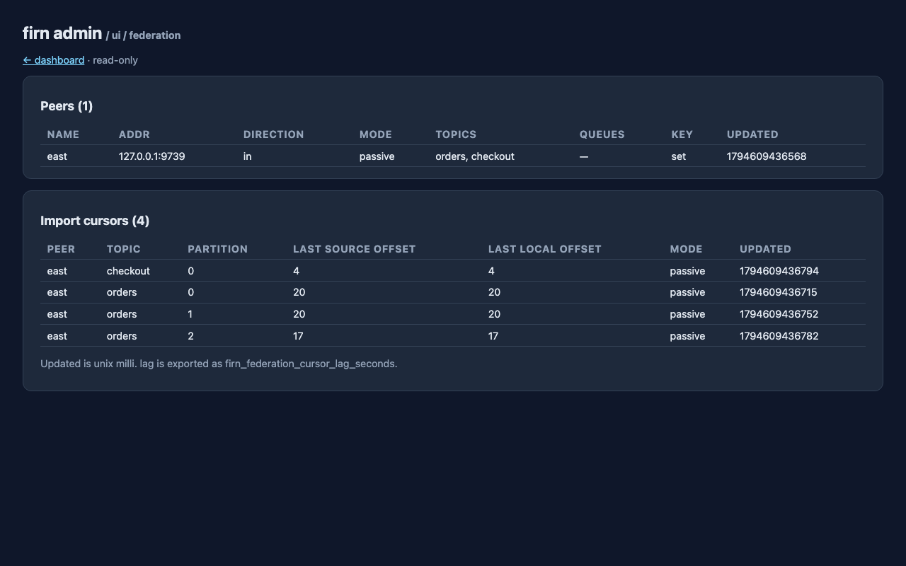

# Firn for developers

How application teams publish, consume, and integrate with Firn from their own services. For installing and running Firn, see [`docs/operator.md`](operator.md).

---

## Concepts in 60 seconds

| Term | Meaning |
|---|---|
| **topic** | Named log with `N` partitions; either `stream` (replay by offset) or `queue` (ack/redeliver/DLQ) |
| **partition** | Independent append-only log inside a topic; ordering is per-partition |
| **offset** | Monotonic record index per partition; never reused; commits advance forward |
| **record** | `key` + `value` bytes, CRC-protected, fsync'd before `Produce` returns |
| **consumer group** | Named set of consumers load-balanced across partitions; commit offsets per partition |
| **high watermark (HWM)** | Next offset to be assigned; fetches never return records at or above it |
| **DLQ** | Dead-letter queue for messages that exhaust `maxDeliveries = 3` |

---

## Requesting access (auth)

Application keys are minted by the platform operator — ask them for:

- **role** — `viewer` (read only), `operator` (produce + consume + commit), `admin` (never for applications)
- **`allowed_ips`** — for production, restrict to your service's egress CIDR range
- **rate** — default `-rate 100` ops/s per key; ask for a higher ceiling if you burst

Applications authenticate with a bearer token over gRPC or HTTP. Keep the key out of source control (env var or secret manager):

```sh
export FIRN_API_KEY=ev-...
```

Test a key against a running broker:

```sh
firn-cli -api-key $FIRN_API_KEY list
firn-cli -api-key $FIRN_API_KEY fetch --topic orders --offset 0 --max 10
```

---

## Publishing and consuming

All client verbs are on the gRPC `FirnService` (`internal/api/firn.proto`). HTTP is admin-only — it does **not** carry produce/fetch traffic.

### Go — the official SDK (delivered 2026-11-13)

`sdk/firngo` ships with the module: connect once, produce/fetch/subscribe with auth wired in.

```go
import "github.com/rahulkj/firn/sdk/firngo"

sdk, err := firngo.DialProduction(ctx, "firn.internal:9461", "ev-...", caCertPool)
if err != nil { panic(err) }
defer sdk.Close()

// publish
_, offset, err := sdk.Produce(ctx, "orders", []byte("order-42"), []byte(`{"item":"book"}`))

// publish a batch (one RPC instead of N, cap 500 records per call)
results, err := sdk.ProduceBatch(ctx, "orders", []firngo.KeyValue{
    {Key: []byte("order-42"), Value: []byte(`{"item":"book"}`)},
    {Key: []byte("order-43"), Value: []byte(`{"item":"pen"}`)},
})
// or from the CLI: firn-cli produce --topic orders --batch-file events.jsonl

// consume
recs, err := sdk.Fetch(ctx, "orders", 0, 0, 100)

// subscribe
_ = sdk.SubscribePartition(ctx, "orders", 0, 0, 100, func(r firngo.Record) error {
    fmt.Printf("%s %s\n", r.Key, r.Value)
    return nil
})
```

If you prefer raw gRPC: generate stubs from `internal/api/firn.proto` (protoc + `protoc-gen-go` + `protoc-gen-go-grpc`) and call `FirnServiceClient` directly — same wire format, no wrapper.

### Python (verified against the running broker)

```sh
python -m venv .venv && . .venv/bin/activate
pip install grpcio grpcio-tools
# generate stubs from this repo's proto
python -m grpc_tools.protoc -I internal/api --python_out=. --grpc_python_out=. firn.proto
```

```python
import grpc
import firn_pb2, firn_pb2_grpc

# optional but recommended for production: metadata with bearer key
md = (("authorization", "Bearer ev-..."),)
channel = grpc.secure_channel("127.0.0.1:9461", grpc.ssl_channel_credentials())  # or insecure_channel for dev
stub = firn_pb2_grpc.FirnServiceStub(channel)

# publish
resp = stub.Produce(firn_pb2.ProduceRequest(
    topic="checkout",
    key=b"order-1",
    value=b'{"amount": 1299, "currency": "USD"}',
), metadata=md)
print(f"offset={resp.offset}")

# consume
fr = stub.Fetch(firn_pb2.FetchRequest(
    topic="checkout", partition=0, offset=0, max_records=100), metadata=md)
for rec in fr.records:
    print(rec.key, rec.value)
```

### Java (verified against the running broker — Maven)

`firn.proto` must be at `src/main/proto/firn.proto`. Minimal `pom.xml` dependencies:

```xml
<dependencies>
  <dependency><groupId>io.grpc</groupId><artifactId>grpc-netty-shaded</artifactId><version>1.62.2</version></dependency>
  <dependency><groupId>io.grpc</groupId><artifactId>grpc-protobuf</artifactId><version>1.62.2</version></dependency>
  <dependency><groupId>io.grpc</groupId><artifactId>grpc-stub</artifactId><version>1.62.2</version></dependency>
  <dependency><groupId>jakarta.annotation</groupId><artifactId>jakarta.annotation-api</artifactId><version>2.1.1</version></dependency>
  <dependency><groupId>javax.annotation</groupId><artifactId>javax.annotation-api</artifactId><version>1.3.2</version></dependency>
</dependencies>
```

```java
ManagedChannel channel = ManagedChannelBuilder.forAddress("127.0.0.1", 9461)
    .usePlaintext()   // dev only — production: .useTransportSecurity() with your CA
    .build();
FirnServiceGrpc.FirnServiceBlockingStub stub =
    FirnServiceGrpc.newBlockingStub(channel)
        .withCallCredentials(new BearerCredential(System.getenv("FIRN_API_KEY")));

// publish
ProduceResponse pr = stub.produce(ProduceRequest.newBuilder()
    .setTopic("checkout")
    .setKey(ByteString.copyFromUtf8("order-1"))
    .setValue(ByteString.copyFromUtf8("{\"amount\":1299}"))
    .build());

// consume
FetchResponse fr = stub.fetch(FetchRequest.newBuilder()
    .setTopic("checkout").setPartition(0).setOffset(0).setMaxRecords(100).build());
```

> **Build gotchas this release was tested against**: on JDK 21+, `javax.annotation.Generated` is gone — you need `javax.annotation-api` (and/or `jakarta.annotation-api` for newer stubs). For an executable fat jar add `ServicesResourceTransformer` to `maven-shade-plugin`, otherwise `META-INF/services` entries from `grpc-core` (the DNS resolver) are dropped and channel creation fails with `NameResolver 'unix' not supported`.

### .NET (not executed here — shape follows the proto)

```sh
dotnet add package Grpc.Net.Client Grpc.Net.Client.Web
# + generated stubs from firn.proto (dotnet-grpc tool or Grpc.Tools MSBuild task)
```

```csharp
var channel = GrpcChannel.ForAddress("http://localhost:9461",
    new GrpcChannelOptions { HttpHandler = new HttpClientHandler {
        // Dev / plaintext only; production: switch to https with your CA
    }});
var client = new FirnService.FirnServiceClient(channel);
var resp = client.Produce(new ProduceRequest {
    Topic = "checkout",
    Key = ByteString.CopyFromUtf8("order-1"),
    Value = ByteString.CopyFromUtf8("{\"amount\":1299}") },
    headers: new Metadata { { "authorization", $"Bearer {Environment.GetEnvironmentVariable("FIRN_API_KEY")}" } });
Console.WriteLine($"offset={resp.Offset}");
```

---

## UI screens useful to developers

### Dashboard — `:9460/ui/`



Topics with partition counts and mode, consumer groups with generation/protocol/leader/member count, and a link to the federation view. Read-only; every change still goes through the API or CLI (that's deliberate — no one clicks "delete topic" by accident). Browser access needs a key — `POST /ui/session` exchanges it for an HttpOnly cookie (see [operator docs](operator.md#metrics--ui)); `-dev` skips auth entirely for local brokers.

### Federation — `:9460/ui/federation`



If your application consumes from a federated cluster: per-peer direction, mode, topic scope, and per-partition import cursor offsets — exactly where the data you're reading is coming from, right now. Also exports `firn_federation_cursor_lag_seconds`.

---

## Developer CLI commands

| Command | Typical use |
|---|---|
| `firn-cli produce --topic T --key K --value V` | smoke-test publishes |
| `firn-cli produce --topic T --batch-file events.jsonl` | bulk publishes (one RPC per 500 lines) |
| `firn-cli fetch --topic T [--partition P] [--offset N] [--max N]` | read records; `--json` for machines |
| `firn-cli list` | which topics exist (name + partitions + mode) |
| `firn-cli groups` | your consumer group's members, generation, leader |
| `firn-cli dlq list --queue Q` | inspect dead letters |
| `firn-cli dlq redrive --queue Q` | re-enqueue all DLQ messages (at-least-once) |
| `firn-cli federation status` | if you consume a federated topic |
| `firn-cli list-apikeys` | which application keys exist (admin only) |

---

## Best practices

- **Always set a key.** Without a key, partition assignment is round-robin — ordered processing per entity is lost. With a key, `FNV(key) % partitions` pins the entity to one partition.
- **Consume -> commit last.** In queue mode, `Pull`, process, then `Ack` — and never ack before the work is durable on your side. Visibility timeout protects against double delivery, not against your own crashes.
- **Expect at-least-once.** Redelivery after `maxDeliveries = 3` diverts to `<queue>.dlq`. Design handlers idempotently (compare-and-set on a business key; dedupe table; or use deterministic IDs).
- **Use groups for horizontal scale.** All consumers in a group share the partitions; a restarted member is re-assigned its previous partitions.
- **Choose stream vs queue by semantics, not by data rate.** Durable replayable log → stream + consumer groups. Work queue with acks/redelivery → queue.
- **Keep values self-describing.** Include a schema/version field; Firn stores opaque bytes and will happily carry an unversioned binary blob into the next decade.
- **Bound your fetch.** `max_records` and poll budgets are your friend; an empty topic returns zero records, not an error.
- **Keys over partitions for hot entities.** If 80% of your traffic is one tenant key, it's one partition — hot-spot by design. Hash the key with the partition count in mind (re-partitioning is a data migration).

---

## Troubleshooting

| Symptom | Cause | Fix |
|---|---|---|
| `TopicNotFound` | topic doesn't exist on this cluster | `firn-cli create-topic ...` or check `firn-cli list` |
| `FailedPrecondition: topic/partition is federated passively` | writes to a passive-federated topic on the sink | produce on the source cluster; reads still work everywhere |
| `FailedPrecondition: not lease holder` | cluster mode, this node isn't the partition's lease holder | client should use `GetMetadata` to find the holder; CLI handles this automatically |
| `PermissionDenied` / `Unauthenticated` | key missing, wrong role, or CIDR mismatch | confirm role ≥ `operator`, check `allowed_ips` |
| `ResourceExhausted` | per-key rate limit (`-rate`) hit | ask operator to raise the key's limit or back off |
| `Unimplemented` | not a queue manager node / RPC not wired on this listener | check you dialed `:9461` (client gRPC), not `:9471` (mesh) |
| `Fetch returned zero records on a non-empty topic` | `offset ≥ HWM` | offsets are per-partition; check `--partition` |
| Consumer group gets stuck / no assignment | heartbeats missed (10s session timeout) | restart the member; `firn-cli groups` shows current members |

---

## Further reading

- [`docs/api.md`](api.md) — full RPC/endpoint reference incl. error codes
- [`docs/operator.md`](operator.md) — installing, configuring, sizing, upgrading Firn
- [`docs/adr/002-api.md`](adr/002-api.md) — why the API is gRPC + HTTP, not wire-compatible with anything
- [`docs/adr/012-architecture.md`](adr/012-architecture.md) — system map
