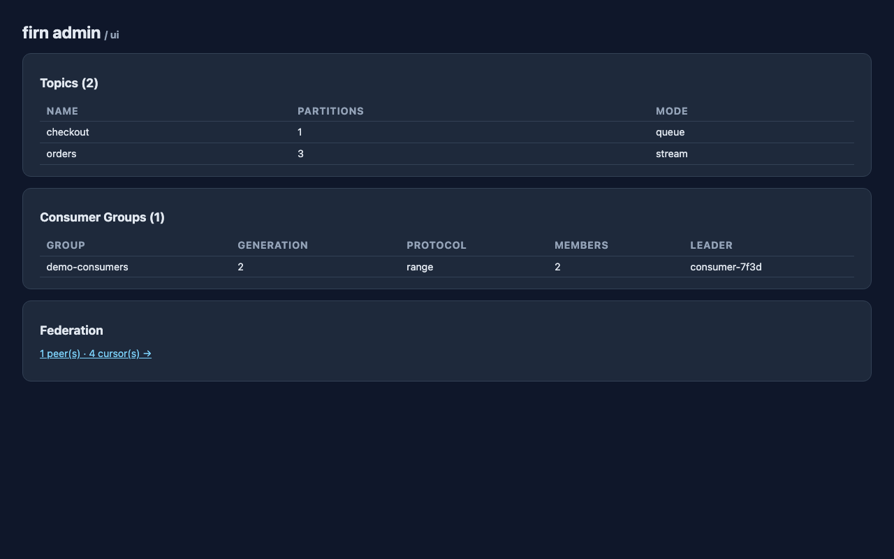
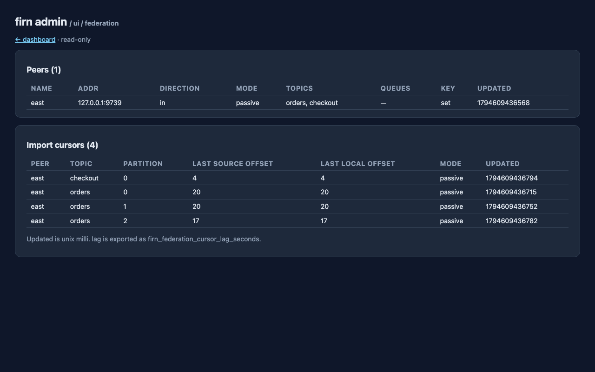

# Firn platform operator guide

For the person who installs, configures, and runs Firn in production. This is the day-to-day companion to [`docs/install.md`](install.md) (first boot), [`docs/configuration.md`](configuration.md) (every flag), and [`docs/adr/012-architecture.md`](adr/012-architecture.md) (system map).

**Audience:** platform operator · **UI:** [`/ui/`](#ui-screens) and [`/ui/federation`](#ui-federation) · **CLI:** `firn-cli`

## What Firn is, briefly

Firn is a durable event broker for Go applications, providing streaming (topics, partitions, offsets, replay, consumer groups) and queue (acknowledgements, redelivery, dead-lettering) over one append-only log. Single binary (`firnd`), embedded storage, zero external service dependencies.

- **Single-node** for dev/small deployments
- **HA cluster** (3 nodes, embedded Raft quorum, write leases, sealed-block replication) for production
- **Multi-cluster federation** (two+ independent clusters, passive one-way or active-active) for DR, read scaling, or active-active regions

Architecture details: [`docs/adr/012-architecture.md`](adr/012-architecture.md).

---

## Network setup

### Default ports (all overridable; IANA-unassigned block)

| Listener | Flag | Default | Carries | Auth |
|---|---|---|---|---|
| HTTP admin | `-http-addr` | `:9460` | `/healthz` (public), `/metrics`, `/ui/`, admin JSON | Bearer once any key exists |
| Client gRPC | `-grpc-addr` | `:9461` | `FirnService` — all client RPCs (produce/fetch/queue/groups/metadata) | Bearer + role |
| Mesh gRPC | `-mesh-addr` | `:9471` (= gRPC + 10) | `ReplicaService`, `QuorumService`, `FederationService` — **mTLS only** | mTLS + federation key |

Cluster example (n1/n2/n3): HTTP `9537/9539/9541`, gRPC `9538/9540/9542`, meshes `9548/9550/9552`.

### Firewall rules

| From → To | Ports | Why |
|---|---|---|
| App clients → every node | `9460/tcp` (admin, optional), `9461/tcp` (gRPC) | Client traffic |
| Every node → every node (same cluster) | `mesh port` (default gRPC+10; e.g. `9471`) | mTLS quorum + replication |
| Cluster → peer cluster(s) | federation peer mesh ports (e.g. cross-cluster `9471`) | pull-only federation via mTLS |
| Prometheus or agent → node | `9460/tcp` (`/metrics`) | scraping — key required |

- Federation is **pull-only**: the sink dials out to the source. Nothing new is exposed to the network; two federated clusters need bidirectional reach between mesh ports only (each side pulls from the other when direction=both).
- `/healthz` is unauthenticated by design (load-balancer probes, Kubernetes liveness).
- Mesh traffic never crosses the client port; clients cannot reach ReplicaService/QuorumService/FederationService.

### TLS

```sh
firnd -tls-cert /etc/firn/tls.crt -tls-key /etc/firn/tls.key \
      -data-dir /var/lib/firn -dir-mode-check=true
```

- Same cert on HTTP and gRPC listeners (one cert, shared). SAN must cover every host/IP clients and operators dial.
- TLS 1.2+ only; no client certificates on the client surface — clients authenticate with API keys.
- Mesh CA (mTLS) is separate and mandatory: `firn-cli mesh-ca init -out mesh-ca` once per cluster, copy `ca.crt`+`ca.key` into each node's `<data-dir>/mesh-ca/` with `0600`, or pre-provision with `-mesh-ca-bundle`/`-mesh-ca-key`.

---

## Cluster mode (v0.5.0) — what GA means

Cluster mode is **GA as of v0.5.0**, scope honestly bounded. Net-new in v0.5.0 over v0.4.0:

- **Replication actually worked** — the replication agent dialed the *client* gRPC listener with insecure credentials while `ReplicaService` lives only on the mesh mTLS listener, so no blocks were ever replicated in v0.4.0. Fixed: the agent now dials the mesh address with the cluster mesh CA (mirroring the quorum transport's identity).
- **DLQ diversion no longer silently drops poison messages** in multi-node: auto-created `<queue>.dlq` topics now go through the quorum (every node has the topic), and when this node isn't the DLQ partition's lease holder the record is delivered via a new mesh-only `RoutedBrokerService` (`RoutedProduce`). A divert failure now fails the claim and leaves the source offset unconsumed — **at-least-once is preserved** (previously: silently drop).
- `ErrNotLeaseHolder` now maps to `FAILED_PRECONDITION` (was `INTERNAL`).
- Live validation: 2-node and 3-node clusters; topic create/produce/fetch, replication catch-up after a node rejoin, kill -9 + restart round-trip, queue lifecycle incl. DLQ divert through the mesh path, internal-topic fencing (non-holder writes fail closed with 503/FailedPrecondition and `firn-cli` retries the holder).

**The GA envelope (unchanged from v0.4.0's experimental caveats — these are structural, not bugs):**

1. **Single-region, fixed membership.** No dynamic join/leave. Adding/removing nodes = full restart window.
2. **3+ voting nodes for HA.** A 2-node cluster can lose nothing — one node down = no quorum = **writes blocked** (fetches still serve). 2-node is dev/test only.
3. **Full-restart upgrades**, not in-place rolling (storage-adjacent; rolling upgrades not supported — blast radius is all nodes).
4. **Lease re-grants land on the quorum leader**, not the original owner — expect topic/partition leader affinity to cluster movement; ADR-007 documents the lease model and the re-grant limitation.
5. **Unsealed tails (≤ `--lease-ttl`, default 5s) are the at-risk window** — a killed holder can lose the unsealed tail; mitigate with `-block-seal-interval` (documented flag) or by treating `-lease-ttl` as your RPO knob.
6. **Internal topics are single-writer-fenced** via the internal lease (`__consumer_offsets`, `__queue_attempts`, `__audit`, `__api_keys`): non-holder nodes fail closed on their writes. Reads open everywhere.
7. **Client routing** rides `GetMetadata` + the CLI's retry-on-`FailedPrecondition`/`Unavailable` with a 2 s metadata cache; stale entries converge on retry.
8. **No exactly-once.** Consumer groups and queue mode are at-least-once. At-least-once offset semantics for groups holds (commit offsets monotonic unless explicit reset).

**Not in GA (still out of scope):** multi-region quorum, dynamic membership, rolling upgrades without a restart window, automatic unsealed-tail recovery, wire compatibility with Kafka/Redpanda.

## Consistency & acknowledgement model (whole product, v0.5.0)

- **There is no `acks` knob.** Do not reach for one in another broker's documentation; match firn's knobs, which are all about durability scope and batching, not wire flags.
- **Default durability**: one fsync per partition-log append (`acks=1` semantics in other brokers, same meaning, different spelling).
- **`-flush-window` (ADR-014)**: one fsync per window of appends; the ack returns after the fsync of the batch that covers the record, not after the record's own flush. If you enable it, you've opted into bounded loss on hard crash (messages acknowledged but unflushed are redelivered by the caller's at-least-once retry). Read `docs/adr/014-group-commit.md` before flipping it on.
- **Replication (cluster mode)**: a record's *block* is committed via the quorum once a majority holds a copy; individual produce paths still ack on the local disk before that commit lands (the at-least-once window is the same shape as the unsealed-tail caveat in ADR-007; replication raises durability further but does not make produce-side acks causally dependent on quorum commit in this release).
- **At-least-once only.** Messages may be redelivered; design consumers to be idempotent (compare-and-set on a business key, dedupe table, deterministic IDs). Consumer-group offsets advance monotonically unless an operator explicitly resets them.
- **No `acks=all` flag, no transactions, no read-your-writes across partitions.** If you need one of those, you need a different broker — not a flag here.

## Sizing — how big a machine do I need?

Measured on Apple M3 Pro, darwin/arm64, local NVMe (`go test -bench=. -benchmem -benchtime=2000x ./bench/...`):

| Operation | ns/op | Rate | Notes |
|---|---|---|---|
| Produce (durable, fsync per append) | ~2.0–2.8 ms | **~350–500 msg/s** (single broker, any/all partitions) | includes full fsync — this is the honest number, not in-memory |
| Produce (in-memory `MemLog`, dev only) | ~250 ns | ~4M msg/s | slice-1 path only; never production |
| Fetch (128-record batch, durable log) | ~133–144 μs | ~900k records/s read | random or sequential reads; fetch is not a bottleneck |

**What these numbers do and don't scale.** Fetch rate (above) is roughly linear per responding partition and reads/cached can parallelize across partitions and nodes. Produce rate does **not**: the append path takes a single mutex, every partition pays the same fsync, and on a cluster each partition has exactly one lease holder. More partitions or more nodes do **not** raise durable produce TPS — the fsync is the wall (and in a cluster, the write lease is the one writer at a time). To raise aggregate produce TPS shard upstream, or opt in to the group commit / flush-window storage policy (ADR-014; `-flush-window=2ms`, measured ~186k msg/s, off by default pending storage review — see `docs/plans/006-throughput.md`).

### Partition budget — how many partitions per node?

Measured on the same machine (broker created fresh, one record produced per partition):

| Partitions created | Result | Open FDs |
|---|---|---|
| 200 | all produce | 211 |
| 1,000 | all produce | 1,011 |
| 2,500 | all produce, ~2.7 ms per create+produce op (dominated by fsync) | 2,512 |

**There is no hard-coded cap.** The limits, in order of appearance:

1. **File descriptors.** Every segment = one open FD. Linux default `ulimit -n` of 1024 caps you at a few hundred partitions; 4096 caps you near two thousand. Set **`ulimit -n 65536`** (systemd: `LimitNOFILE=65536`) before exceeding a few hundred partitions.
2. **Metadata/quorum churn.** In clusters, every sealed block (~64 MiB) emits one descriptor — thousands of partitions multiplying segment rolls multiply descriptor rate, but a 3-node quorum shrugs at this for a long while.
3. **Produce throughput does **not** scale with partition count.** Measured: 300 durable produces finished in 699 ms across 3 partitions (2.33 ms/op) and 981 ms across 1,000 partitions (3.27 ms/op) — fsync-per-append is the wall, everything serializes on the broker's append path, and partitions spread ordering, not throughput.

**Practical guidance:**

- **Hundreds per node** is the clean number. **Thousands** work if you raise `ulimit -n` and accept slower per-write latency. **Tens of thousands** is not supported in any meaningful sense — not because of memory or FDs, but because of the produce path above.
- Sizing `-segment-bytes` larger reduces segment rolls and open FDs per partition (each segment holds 1 FD), at the cost of coarser retention granularity.
- If you find yourself wanting thousands of partitions per node, question the sharding — it usually means per-tenant topics that don't need isolation, not a real scaling requirement.

**Rules of thumb (validate with `go test -bench=. ./bench/...` on your hardware — NVMe vs. SATA vs. network storage matters enormously):**

| Workload | CPU / RAM | Disk | Expected |
|---|---|---|---|
| Dev/test (single node) | 1 vCPU / 1 GiB | 5–20 GiB | full feature set; ~350–500 msg/s aggregate produce (fsync-bound) |
| Small prod (single node, low rate) | 2 vCPU / 2–4 GiB | ≥ 2× retention window (e.g. 100 GiB) | correct, not fast; partitions 1–4 |
| Medium prod (3-node cluster) | 4 vCPU / 8 GiB per node | ≥ 2× retention × replication factor | failover; ~350–500 msg/s per partition range; aggregate produce TPS equals single-node — cluster buys availability, not throughput |
| Large (many partitions/topics) | 8+ vCPU / 16–32 GiB per node, NVMe | sized by retention math | mostly fetch-bound reads; watch `firn_fsync_seconds`, keep partition counts tight |

**Retention math.** `firn` deletes *whole segments* only — it never rewrites offsets — so sizing is: bytes that must stay live = `target_retention_window` × produce rate. Example: 2 MiB/s of writes with 7-day retention ⇒ ~1.2 TiB live (firn does not compress — there is no compression option). With ×3 replication across the cluster ⇒ plan 3.6 TiB raw. Set `-retention-ttl 168h` and/or `-retention-max-bytes 137438953472` (128 GiB). Use `-segment-bytes` small enough that whole-segment deletes are granular enough for your retention window (default 64 MiB is fine for most; go lower if you want finer time-based deletion granularity).

**CPU is mostly fsync + CRC.** Produce throughput is ~350–500 msg/s broker-wide on a durable log with fsync-per-append (ADR-003; measured ~2 ms/op). Sharding by partition **does not** increase produce throughput — it increases ordering scope and replication parallelism. Batching beyond that requires the flush-window group commit (ADR-014, `-flush-window=2ms` measured ~186k msg/s vs ~370 default; off by default, storage review pending).

**Memory.** In-memory index is proportional to record count, not bytes; partition budget (above) dominates the practical ceiling long before RAM.

---

## Storage integrations

### Local filesystem (default, supported)

`<data-dir>` layout:

| Path | Contents |
|---|---|
| `topics.json` | Topic registry (name, partitions, mode). Atomically renamed + fsynced. |
| `<topic>-<partition>/` | Segment files (`.log`) + in-memory sparse index (rebuilt on open; no `.index` sidecar files yet). |
| `__consumer_offsets-0/`, `__queue_attempts-0/`, `__audit-0/`, `__api_keys-0/`, `__federation_peers-0/`, `__federation_cursors-0/` | Broker-owned internal topics (replicated like user topics in cluster mode). |

- **Backup**: stop `firnd`, copy `<data-dir>`, restart. There is no hot backup tool today; do a periodic stopped-copy.
- **Retention**: `-retention-ttl`, `-retention-max-bytes`, `-retention-interval`, `-segment-bytes`, `-block-seal-interval`. Whole-segment deletes only; active segment never deleted.
- **Permissions**: `-dir-mode-check=true` (default) refuses startup if any file is group/world-readable; fix with `chmod -R go-rwx <data-dir>` or temporarily `-dir-mode-check=false`.
- **Filesystem**: local NVMe/SSD strongly recommended. Network filesystems (NFS/SMB) are **not supported** — fsync semantics and CRC checks assume local block devices.

### In-memory (dev only — not production)

`-data-dir ""` selects `MemLog`. Everything is lost on restart. Do not run production workloads on it.

### Object storage / S3 / blob

**Not supported.** There is no S3/Azure Blob/GCS code path anywhere in the broker, by explicit decision (ADR-009, ADR-001; archive tier tracked as future work in plan 002-ha "Phase G"). If you need cloud object storage, the options today are: run Firn locally (recommended for durability) and copy backups to object storage out-of-band with any sync tool. Do not put a working broker's data dir on object storage via a FUSE mount.

The block engine (ADR-007) and content-addressed sealed blocks were designed for exactly this future path — but it isn't built.

---

## Installing Firn

Two supported paths.

### From the release tarballs (v0.5.0)

```sh
# pick one; verify against SHA256SUMS from the release
tar -xzf firn-v0.5.0-linux-amd64.tar.gz
sudo install -m 0755 firnd /usr/local/bin/firnd
sudo install -m 0755 firn-cli /usr/local/bin/firn-cli
```

Binaries are static, no libc dependency. Download at <https://github.com/rahulkj/firn/releases/tag/v0.5.0> (verify with `shasum -a 256 -c SHA256SUMS`; see [`docs/distribution.md`](distribution.md)).

### From source

```sh
git clone https://github.com/rahulkj/firn
cd firn
make build          # or: go build ./...
make verify         # go vet ./... && go test ./...
go build -o firnd ./cmd/firnd && go build -o firn-cli ./cmd/firn-cli
```

### First boot (fail-closed)

A fresh broker serves **nothing** except `/healthz` until an admin key exists:

```sh
firnd -data-dir ./data
# stderr prints: BOOTSTRAP TOKEN: <hex>   (shown once; void once used)
TOKEN=<hex>
curl -s -X POST localhost:9460/apikeys -H "Authorization: Bearer $TOKEN" \
     -H 'Content-Type: application/json' -d '{"name":"root","role":"admin"}'
```

The token mints exactly one admin key. From then on, `/healthz` is the only unauthenticated route.

---

## Day-to-day operations

### Topics and queues

```sh
firn-cli create-topic --name orders --partitions 3
firn-cli create-queue  --name checkout              # queue-mode topic
firn-cli list
```

### API keys

```sh
firn-cli create-apikey --name ci-deploy --role operator                 # producer automation
firn-cli create-apikey --name dashboard --role viewer --allowed-ips 192.0.2.0/24   # RFC 5737 documentation range (EXAMPLE)
firn-cli list-apikeys
firn-cli revoke-apikey --name ci-deploy
```

Keys are shown once and hashed at rest. Roles: `viewer < operator < admin`, plus `federation` for cross-cluster peers (can call `FederationService` and nothing else).

### Metrics & UI

```sh
curl -H "Authorization: Bearer $VIEWER_KEY" localhost:9460/metrics
```

Browser: the admin UI can't use a bearer header, so the browser authenticates with a one-time **session cookie**:

```sh
firn-cli create-apikey --name dashboard --role viewer
# exchange the key for a session cookie (12h, HttpOnly, SameSite=Strict, Path=/ui/)
curl -i -X POST localhost:9460/ui/session -H "Authorization: Bearer $DASHBOARD_KEY"
# → 201 Created, Set-Cookie: firn_ui_session=ev-…; Path=/ui/; HttpOnly; SameSite=Strict; Max-Age=43200
```

Then give the browser that cookie once: DevTools → Application → Cookies → `http://<host>:9460` → add `firn_ui_session` with the value from `Set-Cookie`. Subsequent visits to `/ui/` and `/ui/federation` just work. (A one-line bookmarklet doing `fetch('/ui/session',{method:'POST',headers:{Authorization:'Bearer '+key}})` avoids the DevTools dance; a browser extension that sets the cookie works too.) `DELETE /ui/session` with the cookie signs out. Sessions are in-memory — a restart signs everyone out — and re-verify the key on every request, so revoking the `dashboard` key kills its sessions immediately.

For a multi-user deployment, a reverse proxy with a pinned viewer key + TLS (see Network setup) remains the cleaner pattern — no per-browser cookie setup. `-dev` disables auth entirely — development only.

### Health checks

```sh
curl localhost:9460/healthz     # {"status":"ok","version":"0.4.0"}
```

---

## UI screens



Topics and consumer groups at a glance, links to the federation view. Read-only by design — every mutation goes through the admin API or `firn-cli`.



Federation peers, their direction/mode/selectors, and import cursors with per-`(peer, topic, partition)` progress. `firn_federation_cursor_lag_seconds` is exported for scraping.

---

## Monitoring & logging integration points

| Signal | How to get it | Ship to |
|---|---|---|
| Metrics | `GET /metrics` (viewer key) | Prometheus, then Grafana; pushgateway if push-only |
| Logs | stdout/stderr structured JSON via `slog` | journald, Vector/Fluent Bit, CloudWatch, Loki, Elastic |
| Health | `GET /healthz` | Kubernetes liveness/readiness, LB target checks |
| Audit | `__audit-0` (append-only) + `FIRN_AUDIT_MAX_BYTES` bound | any log pipeline; grep `authz-refused` for intrusion evidence |

Example scrape config and alerts: [`docs/sre.md`](sre.md).

---

## All firn-cli commands (operator reference)

| Command | Purpose |
|---|---|
| `firn-cli mesh-ca init [-out DIR]` | generate the cluster mesh CA (run once per cluster) |
| `firn-cli create-topic --name N --partitions P [--mode stream\|queue]` | create a topic |
| `firn-cli create-queue --name N` | create a queue-mode topic |
| `firn-cli list` | list topics |
| `firn-cli groups` | list consumer groups |
| `firn-cli dlq list --queue Q` / `firn-cli dlq redrive --queue Q` | inspect / redrive a dead-letter queue |
| `firn-cli create-apikey --name N --role viewer\|operator\|admin [--allowed-ips CIDRs]` | mint a key |
| `firn-cli list-apikeys` | list keys |
| `firn-cli revoke-apikey --name N` | revoke a key |
| `firn-cli federation add-peer --name N --addr HOST:PORT --direction in\|out\|both --mode passive\|active-active --key KEY [--topics T…] [--queues Q…] [--server-name SAN]` | register a peer cluster |
| `firn-cli federation list-peers` / `federation status` / `federation remove-peer --name N` | inspect / remove peers |
| `firn-cli federation keys --name N` | mint a federation-scoped key for this cluster |
| `firn-cli produce --topic T --key K --value V` | publish (operator/dev use) |
| `firn-cli fetch --topic T [--offset N] [--max N] [--partition P] [--json]` | read |

`firn-cli` output is tabular; pass `--json` for machine-readable output. See `firn-cli <cmd> -h`.

---

## Runbooks

- **Bootstrap / first instance**: see First boot above.
- **Restart safely**: `firnd` is safe to kill -9 (torn-tail truncation on open); restart on the same data dir. Rolling restart of a cluster: restart one node at a time, wait for re-election and participation, verify `firn-cli groups` shows the expected members.
- **Backup**: stop the broker, `cp -a data/ backup/$(date +%F)/`; restart. Test-restore quarterly.
- **Upgrade**: see [`docs/migration-v0.3-to-v0.4.md`](migration-v0.3-to-v0.4.md); never skip a minor-cycle review.
- **Rotate a key**: `firn-cli create-apikey --name new --role …`, switch clients, `revoke-apikey --name old`.
- **DLQ handling**: `firn-cli dlq list --queue Q`; fix the producer or consumer bug; `firn-cli dlq redrive --queue Q` re-queues all messages (at-least-once — consumer must tolerate duplicates).
- **Federation cutover** (passive → writable): see [`docs/federation-cutover.md`](federation-cutover.md).

---

## Personas & where they fit

| Persona | What they use | Primary docs |
|---|---|---|
| Platform operator | this file; `firn-cli`; `/ui/` | this file + `docs/configuration.md` |
| SRE / observer | `/metrics`, `/ui/`, `firn-cli groups/dlq/federation status` | [`docs/sre.md`](sre.md) |
| Application developer | gRPC API, `firn-cli` as a test client | [`docs/developer.md`](developer.md) |
| Security auditor | `__audit-0`, `list-apikeys`, allowlists | `docs/adr/011-secure-mode.md` |
| On-call / incident | `/ui/`, `firn-cli dlq list|redrive`, `/metrics` | [`docs/sre.md`](sre.md) |
| Release manager | tarballs, distribution pipeline | [`docs/distribution.md`](distribution.md) |
| Data owner / analytics consumer | read-only API keys, fetch | [`docs/developer.md`](developer.md) |

---

## What's deliberately not built

- Client SDKs for non-Go languages (Python/Java/.NET) — Go SDK ships (`sdk/firngo`, ADR-013); other languages use gRPC + `internal/api/firn.proto` (see [`docs/developer.md`](developer.md)) or `firn-cli`.
- Object storage / S3 — by design (see [Storage integrations](#object-storage--s3--blob)).
- Encryption at rest — OS-level permissions only; no KMS integration.
- Multiple concurrent UI sessions per key (each `POST /ui/session` issues an independent token) — by design; revoke the key to kill them all, or present a cookie to `DELETE /ui/session` to drop one.
- Automatic audit log rotation — `-audit-max-bytes` bounds the log; rotation is operator-driven.
