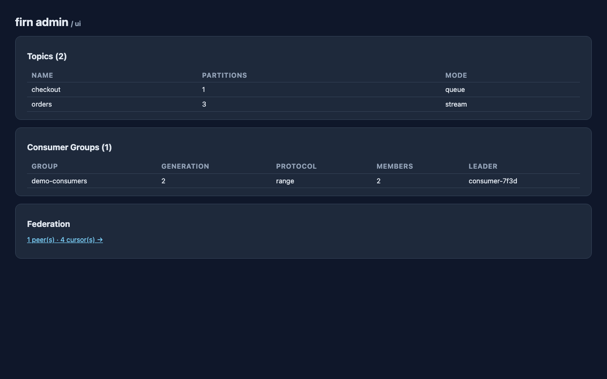
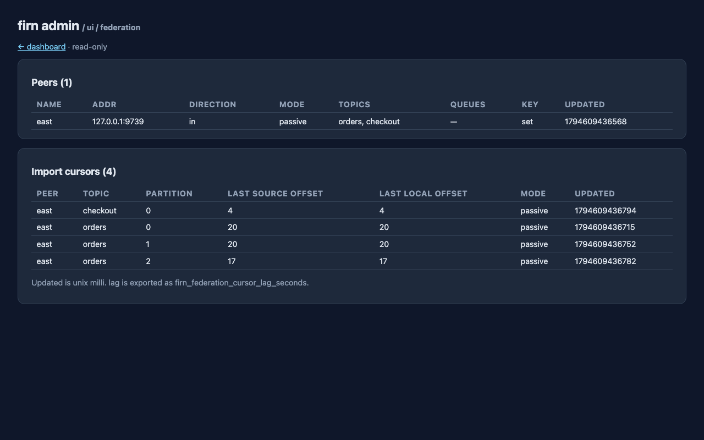

# Firn for SRE / observability

How to wire metrics, logs, and dashboards for a running Firn cluster, and how to answer "is it healthy?" in under a minute.

---

## What to watch

### Golden signals (start here)

| Signal | Metric | Target |
|---|---|---|
| Request success | `firn_produce_total` increments vs. client-side error counts | no sustained gap |
| Latency | `firn_fsync_seconds` (histogram) | p99 < 20 ms warm (per ADR-005); alert > 100 ms |
| Throughput | `firn_produce_total` / `firn_fetch_total` by topic | capacity headroom alert at 80% of target |
| Queue pressure | `firn_queue_depth` | alert > N unacked messages (choose N per queue) |

### Federation (only if federated)

| Signal | Metric | Target |
|---|---|---|
| Import progress | `firn_federation_cursor_lag_seconds{peer,topic,partition}` | alert > 30 s |
| Cursor state | `/federation/cursors` (read-only admin) | partitions track the source HWM |
| Peer liveness | `firn-cli federation status` | all peers `passive` + `direction: in` configured correctly |

### Consumer groups

| Signal | Where | What to check |
|---|---|---|
| Group health | `firn-cli groups` | expected generation, all partitions assigned, no unknown members |
| Rebalance storms | `firn_group_rebalances_total` | > a few per minute means members flapping (network? GC?) |
| Group offsets | HTTP `GET /groups/{name}/offsets` | lag = head HWM − committed offset per partition |
| DLQ growth | `firn-cli dlq list --queue Q` | non-empty DLQ means poison messages or a broken consumer |

### Everything else

| Metric | Type | What it tells you |
|---|---|---|
| `firn_produce_total{topic}` | counter | client produce rate |
| `firn_fetch_total{topic}` | counter | client fetch rate |
| `firn_fsync_seconds` | histogram | durability-bound latency (append path) |
| `firn_group_rebalances_total` | counter | group stability |
| `firn_queue_depth` | gauge | unacked messages + redeliveries across queues |
| `firn_federation_cursor_lag_seconds` | gauge | seconds since last full import per peer/topic/partition |

Scrape example (Prometheus):

```yaml
scrape_configs:
  - job_name: firn
    scrape_interval: 15s
    metrics_path: /metrics
    scheme: http
    authorization:
      type: Bearer
      credentials_file: /etc/firn/viewer-key   # viewer role is enough to scrape
    static_configs:
      - targets:
          - "firn-1:9460"
          - "firn-2:9460"
          - "firn-3:9460"
```

There is **no** push gateway, no bundled Grafana, and no cloud-vendor agent. The `/metrics` endpoint is the contract; everything else is your stack's job — that's deliberate.

### Logs

`firnd` logs JSON to stderr (`slog`). Typical records:

```json
{"time":"2026-11-13T14:38:19Z","level":"INFO","msg":"firnd starting","version":"0.4.0","http":":9460","grpc":":9461"}
{"time":"2026-11-13T14:38:20Z","level":"INFO","msg":"federation: imported","peer":"east","topic":"orders","partition":0,"frames":512}
{"time":"2026-11-13T14:38:21Z","level":"INFO","msg":"http","method":"GET","path":"/topics","status":200,"duration_ms":1}
```

Point journald or your log shipper at it. Structured queries that work on every backend:

- `msg:"federation: imported"` — import throughput
- `msg:"federation: fetch failed"` — peer unreachable
- `msg:"authz-refused"` — intrusion attempts / misconfigured clients
- `msg:"storage permissions check failed"` — data-dir mode drift (or someone `chmod`'d)

### Health checks

| Probe | Use |
|---|---|
| `GET :9460/healthz` → `200 {"status":"ok","version":"0.4.0"}` | Kubernetes `livenessProbe`, LB target checks, systemd watchdog |
| `GET :9460/metrics` (with viewer key) | Prometheus |
| `GET :9460/ui/` | Operator eyeball |

---

## UI screens worth knowing

The admin UI (`:9460/ui/`) is read-only — perfect for "what's happening right now" with a plain `viewer` key (browsers use the `/ui/session` cookie flow — see [operator docs](operator.md#metrics--ui)):



Topics, queues, group membership, federation overlay.



Peer status, per-partition cursors — the definitive "how far behind is the DR copy?" view.

---

## Common SRE workflows

### "Is the broker healthy?"

```sh
curl -s localhost:9460/healthz                       # 200 {"status":"ok","version":"0.4.0"}
firn-cli fetch --topic orders --offset 0 --max 1     # data plane responds
firn-cli groups                                       # membership stable
```

### "Why is my queue backing up?"

```sh
firn-cli list                             # mode = queue?
firn-cli dlq list --queue checkout        # messages hitting max deliveries?
firn-cli groups                           # group membership sane?
curl -H "Authorization: Bearer $VK" localhost:9460/metrics | grep firn_queue_depth
```

### "Which API key is hammering the broker?"

`GET /metrics` doesn't break out per-key. For that you need the broker's logs: `msg:"http"` records carry `path` and `duration_ms` but not the key. For abuse triage: revoke the suspect key (`firn-cli revoke-apikey`) and watch `firn-cli list-apikeys` for the culprit, or check app-side metrics. Per-key rate limiting (`-rate`) is the real seatbelt.

### "Disaster recovery drill"

1. `firn-cli groups` — record expected membership and committed offsets (or export via `/groups/{name}/offsets` JSON).
2. Stop `firnd` on the sink, copy `<data-dir>` to restore target.
3. Restart on target; `GET /healthz`.
4. Verify `firn-cli fetch --topic <critical> --offset 0 --max 1` returns data.
5. Check consumer groups still point at the right offsets.

---

## Alerting starter pack

```yaml
groups:
  - name: firn
    rules:
      - alert: FirnFsyncLatency
        expr: histogram_quantile(0.99, rate(firn_fsync_seconds_bucket[5m])) > 0.1
        for: 10m
        labels: { severity: page }
        annotations: { summary: "firn fsync p99 > 100ms" }

      - alert: FirnFederationLag
        expr: max(firn_federation_cursor_lag_seconds) > 60
        for: 15m
        labels: { severity: warning }

      - alert: FirnQueueDepth
        expr: firn_queue_depth > 10000
        for: 10m
        labels: { severity: ticket }

      - alert: FirnProduceErrors
        expr: increase(firn_produce_total[5m]) == 0 and up{job="firn"} == 1
        for: 30m
        labels: { severity: warning }
        annotations: { summary: "firn alive but zero produce traffic for 30m — client or LB issue?" }

      - alert: FirnGroupRebalances
        expr: rate(firn_group_rebalances_total[10m]) > 0.5
        for: 15m
        labels: { severity: warning }
```
